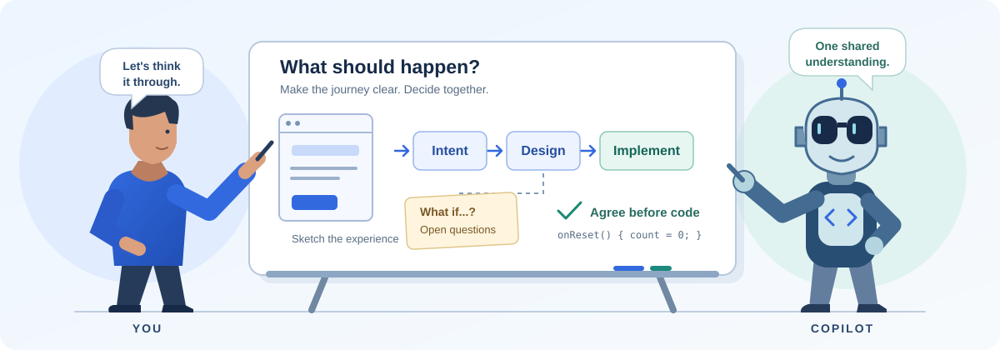

<picture>
  <source media="(prefers-color-scheme: dark)" srcset="development/tandem/public/branding/tandem-blue-dark.png">
  
</picture>

# Tandem

**You and Copilot, thinking together before building.**



Tandem is a collaborative workspace for turning ideas and existing code into
software you understand and intend. Discuss the experience, make decisions
visible in drawings and Design artifacts, then explicitly approve implementation.

It is for developers, designers and project owners who want to work with a coding
agent without leaving product decisions hidden in a prompt.
The illustration above expresses that vision; it is not a product screenshot.

**Watch the 94-second introduction:**

https://github.com/user-attachments/assets/6b068a9d-1669-47bd-a55d-26ced792145a

**Using Tandem: a two-minute highlights tour**

Follow a weekend-away planner through Requirements, drawings, a UI prototype
with mocked data, Design discussion, implementation and Review.

https://github.com/user-attachments/assets/ea2c909b-97c7-44b2-adfe-86ff56e4c382

## Why Tandem?

- **See the idea before committing to it.** Explore requirements, drawings and
  interactive prototypes instead of reconstructing everything from a long spec.
- **Start where your project is.** Discover a new idea or work directly from an
  existing application; Preparation is optional.
- **Keep implementation tied to your decisions.** Review the Design, approve
  the proposed work, and inspect implementation and Review outcomes.

Read [the Tandem story](docs/the-tandem-story.md) for the approach and a concrete
example.

## Get started

**Source preview:** the instructions below build this checkout; they do not
install a published release. Use Windows with PowerShell, actual **Node 24.15+
(24.x LTS) or Node 26+**, Git, and a Copilot account with the required model access.
Other platforms are not yet qualified. The browser app does not require .NET or a running Copilot
desktop app.

From your Tandem source checkout, run:

```powershell
npm ci
npm run login:browser
npm run browser -- --workspace C:\projects\my-app
```

Both browser scripts build the app automatically. Pass launch options after `--`.

Replace `C:\projects\my-app` with your project folder (the repository/worktree root
for existing Git projects), not the Tandem source folder. Before Development,
Tandem offers explicit local Git setup when needed;
[the quick start](docs/quick-start.md) shows both paths. Use a test
project or worktree for your first trial.

**What you will see:** Tandem opens your project folder and asks where to start:

| Start with Preparation | Go to Development |
| --- | --- |
| Clarify an idea through Requirements, Drawings and Prototype, then continue into Development. | Explore existing files or refine a rough idea directly in Design and Conversation. |

The choice is saved for that folder. In Development, review the Design and
answer questions, then request implementation. **Plan and implement** explicitly
authorizes planning and code changes in your selected working copy; opening a
view or finishing a prototype does not.

Keep the launch terminal open. Closing a browser tab leaves work running;
use the host's **Stop** or **Ctrl+C** to exit, and check any reported failure.
Private launch URLs must not be shared.

## Documentation

| Guide | Use it to |
| --- | --- |
| [Quick start](docs/quick-start.md) | Open your first project and reach an implementation decision. |
| [The Tandem story](docs/the-tandem-story.md) | Understand the vision through a concrete example. |
| [User manual](docs/user-manual.md) | Learn the workspace and everyday controls. |
| [Task recipes](docs/use-cases.md) | Revise a prototype, refine Design, or export an outcome. |
| [Troubleshooting](docs/troubleshooting.md) | Handle queued work, unavailable previews, Stop and reopen. |

The [documentation index](docs/README.md) also links advanced configuration and
engineering references.

<details>
<summary>Optional presentation background</summary>

The [six-slide opening presentation](development/docs/tandem-opening-slides-v2.html#1)
and [extended background deck](development/docs/tandem-opening-slides-light.html#1)
provide historical illustrations, a development walkthrough and discussion notes.
The guides above stand on their own. Open the checked-out HTML locally; the
screenshots are not evidence of current capabilities or test results.

</details>

## Development and contributions

Work from source in `src` and `development\tandem`; do not hand-edit the generated
extension under `.github\extensions\tandem`. From the repository root:

```powershell
npm run check
npm test
npm run build
```

For Stage 2 changes, also follow its [contributor instructions](development/AGENTS.md).
See the [engineering reference](docs/engineering-reference.md) for architecture
boundaries, packaging, optional hosts and qualification limits.

For a bug report or proposed change, describe the expected behavior, what happened,
and the source/package version. Keep private launch URLs, credentials and
sensitive project content out of reports. Report security vulnerabilities through
the process in [SECURITY.md](SECURITY.md), not a public issue.

## License

[MIT](LICENSE). Bundled third-party components retain their own licenses.
