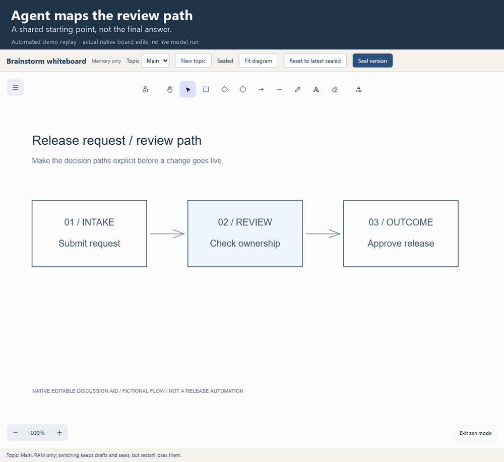
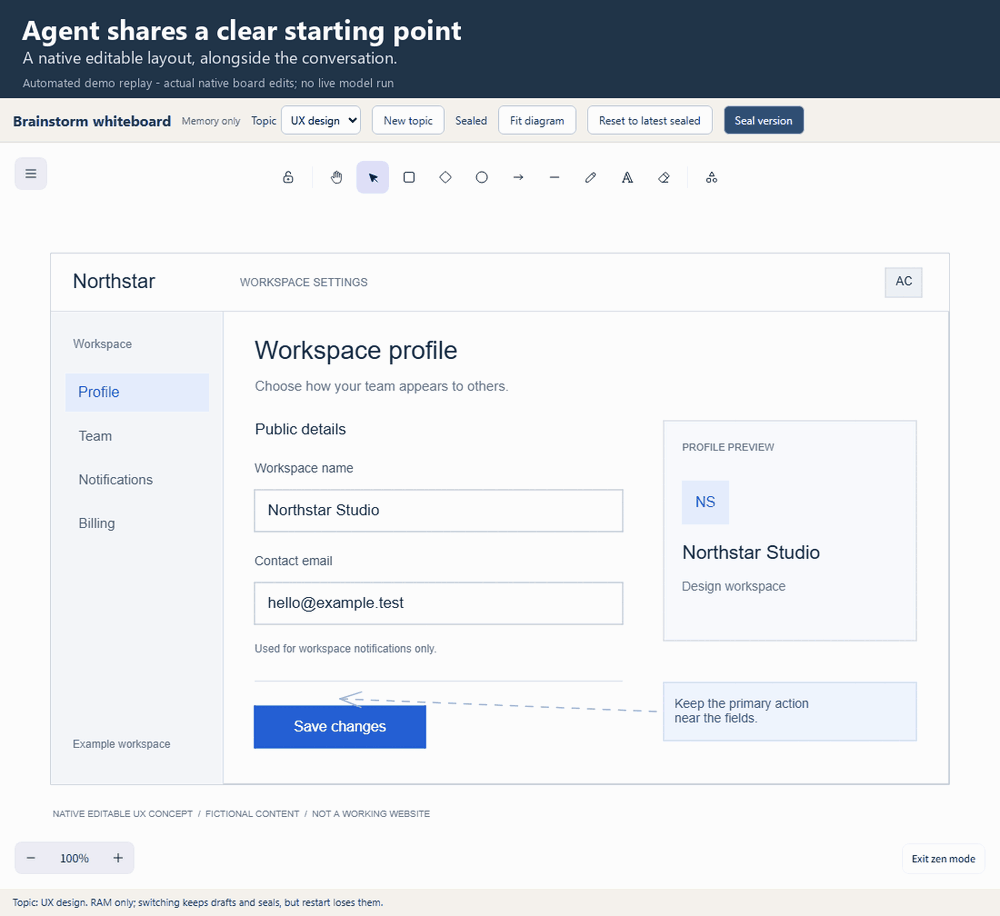
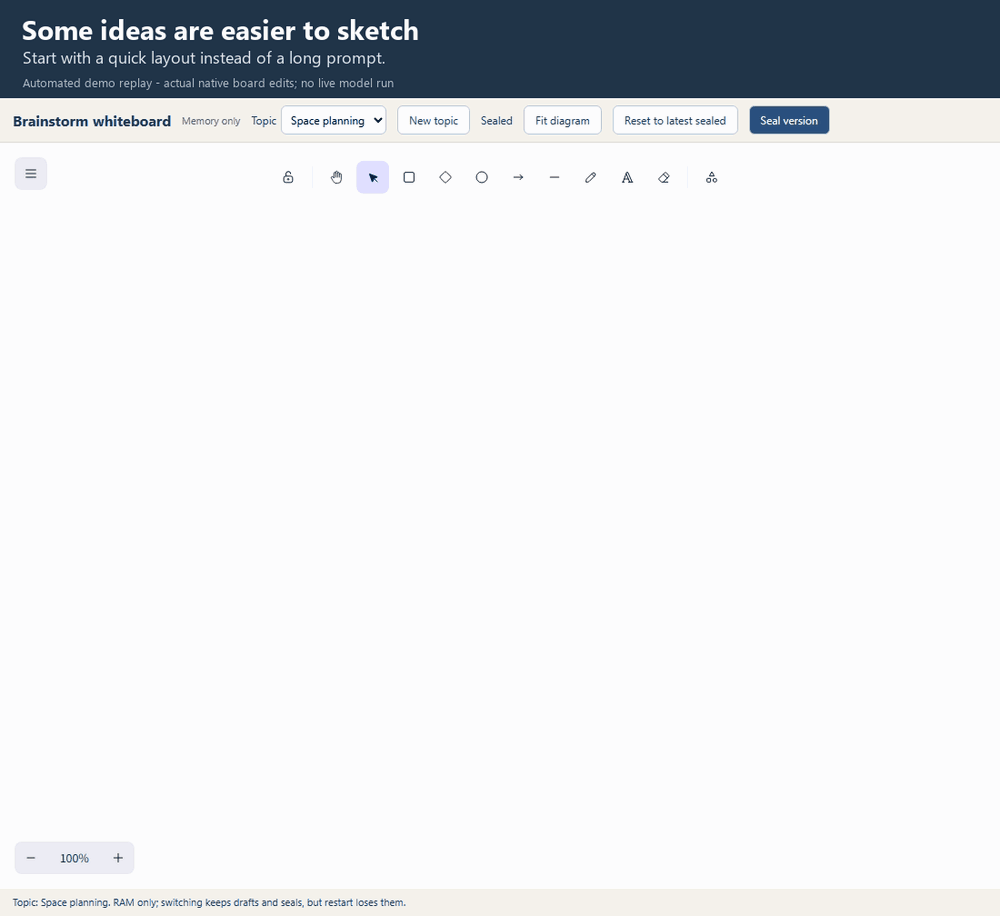

# Brainstorm whiteboard

An optional, Excalidraw-powered visual companion to chat. **Both the human and
the agent can draw, edit, annotate and seal versions as peers.** Show an idea
with a sketch or spatial change when it is easier than typing; the agent reads
the visual and refines the same native objects with you.

Chat stays self-contained: the board supports the conversation, but opening it
is never required to understand an answer. This standalone skill complements
Tandem; it does not replace the framework or require its installation.

## Demos

Automated replays of actual native UI/API edits, not live LLM sessions or
real-human recordings.

### Diagram: add a missing branch

Add and seal a "Request changes" branch. The agent reads the new structure
without replacing it.



### UX: show the change directly

Rename, move and mark a layout; refine it without losing those changes.
This editable concept is not a working website.



### Sketch: start with visual input

Share a spatial sketch. The added clarifying question is illustrative;
the original ink stays intact.



## Get started

### Make the skill available to your agent

For a published repository source containing the marketplace catalogs:

```powershell
# Claude Code
claude plugin marketplace add microsoft/Tandem
claude plugin install brainstorm-whiteboard@tandem-skills

# Codex with plugin-command support
codex plugin marketplace add microsoft/Tandem
codex plugin add brainstorm-whiteboard@tandem-skills
```

Only this skill is selected, not all repository skills. Alternatively, copy
**this entire folder**, including metadata, references, media and `LICENSE.txt`,
using your host's standalone-skill installation method. See
[host packaging and local-folder options](references/maintenance.md#host-packaging)
for existing-checkout registration and direct local loading.

**Native Claude Code/Codex installation and activation remain unqualified.**
The formats follow official host documentation/source. The board needs no
Copilot or Excalidraw account; the chosen agent retains its normal access and
tool-permission requirements.

### Prepare and start the board

Plugin discovery does **not** install dependencies, build the editor or start
a service. With **Node 24.15+ or Node 26+**, npm and registry access, run from
the installed or copied skill directory:

```powershell
npm ci
npm run build
node scripts\whiteboard.mjs serve
```

Open the printed `http://127.0.0.1:<port>/` in a modern browser and keep the
command running. Reuse that board for the conversation; Ctrl+C stops it.

PNG snapshots need installed Edge on Windows, or prepared Playwright Chromium
elsewhere (`npx playwright install chromium` after `npm ci`). The agent also
needs image-reading tools to interpret snapshots; otherwise it must disclose
that visual review was not performed.

## Use it alongside chat

> Help me compare two retry strategies. Explain the trade-offs in chat and use
> Brainstorm whiteboard if an editable sketch helps. I may move or mark the
> sketch to show what I mean.

Either peer can start the visual. Choose a topic, edit native shapes, labels,
connectors or ink, then **Seal version** when sharing a stable handoff.
The agent reads that exact seal and its factual changes, explains its
interpretation in chat and preserves your input when refining. Sealing is not
approval and does not trigger an agent automatically.

## Essential limits

- **Memory only:** stopping or restarting the service loses every working
  drawing and seal. Requested downloads are exports, not autosave or restoration.
- Native editable objects are supported, not arbitrary Excalidraw fields or
  imported HTML/SVG/raster content. Geometry helpers reject unsupported edits.
- The agent interprets meaning; object differences do not establish intent.
  Preserve pending peer work and use guarded edits, not blind replacements.
- Browser/API checks do not qualify native-host activation, live-agent
  portability or physical pen/touch. Source setup is not zero-setup.

## Further reading and license

- [Agent instructions](SKILL.md): activation, topics, peer handoffs and controls.
- [API and native elements](references/api-and-elements.md): supported contracts.
- [Editing cookbook](references/editing-cookbook.md): executable native recipes.
- [Visual authoring](references/visual-authoring.md): composition and exact-image review.
- [Host packaging and maintenance](references/maintenance.md): formats, versions and checks.

This skill is [MIT-licensed](LICENSE.txt). Its editing/rendering engine is
[Excalidraw](https://github.com/excalidraw/excalidraw), also
[MIT-licensed](https://github.com/excalidraw/excalidraw/blob/master/LICENSE).
Retain the license when copying the folder; dependencies and bundled fonts
retain their own notices.
