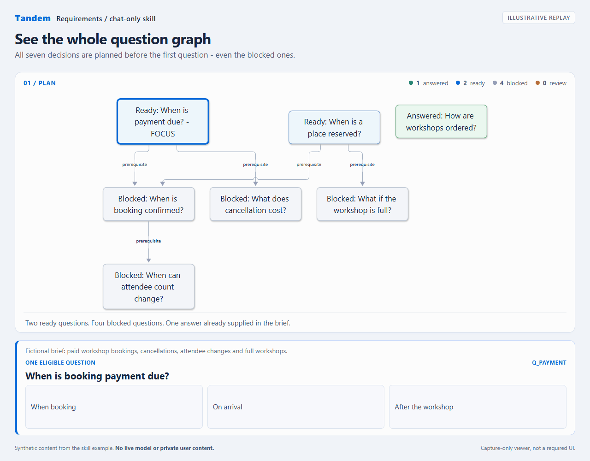

# Requirements

**Requirements is a standalone, agent-neutral skill for clarifying what you want
before work begins.** It helps you turn a brief into a shared understanding,
resolve important choices, and confirm that nothing is missing, all in your
existing agent conversation. You do not need to install the Tandem framework.

Choose it when a request has interacting decisions, when you want to see what
is settled and what still needs thought, or when changes should preserve the
decisions you have already made. A clear brief can go straight to confirmation;
this is not a mandatory interview.

Like [Brainstorm whiteboard](https://github.com/microsoft/Tandem/tree/main/skills/brainstorm-whiteboard),
Requirements is independently usable. Unlike the board, it needs no browser,
local server, Node/npm setup or extra runtime. Your chosen agent's normal
account, model access and tool permissions still apply; the skill adds no
Copilot-specific account requirement.

## Getting started

### Try the PR checkout now

Requirements is introduced by [PR #78](https://github.com/microsoft/Tandem/pull/78).
Until it is merged, do not expect the default-branch marketplace to contain it.
Use a checkout of the PR or a copy of its `skills\requirements` folder.

For a separate review checkout, with Git and GitHub CLI already available:

```powershell
gh repo clone microsoft/Tandem Tandem-requirements
Set-Location .\Tandem-requirements
gh pr checkout 78
```

Use a new destination folder so this does not switch an existing working
project's branch. No `npm install`, build or Tandem startup is needed.

**The simplest path is to load the instructions directly.** In your existing
agent conversation, give the actual absolute path to the checked-out file:

> Read `C:\projects\Tandem-requirements\skills\requirements\SKILL.md` and use the
> Requirements skill for this task: I want a workshop-booking site. Help me
> clarify what visitors can do before we start implementing it.

Replace the example path and brief with your own. This is manual loading through
the agent's normal file-reading capability, not a claim of automatic skill
discovery. If the host cannot read local files, attach the `SKILL.md` text through
its supported conversation interface. Keep your existing context and decisions.

For native plugin loading, choose the route your host supports:

| Host | Load from the PR checkout |
| --- | --- |
| Claude Code | Start it in your target project with `claude --plugin-dir "C:\projects\Tandem-requirements\skills\requirements"` to load the local plugin for that session. |
| Codex with plugin-command support | From the PR checkout's repository root, run `codex plugin marketplace add .`, then `codex plugin add requirements@tandem-skills`. This registers the local catalog and installs the selected skill, not the Tandem framework. |

Replace the checkout path as needed. Local marketplace registration changes
host configuration; if `tandem-skills` is already registered from another
source, prefer direct instruction loading for this trial rather than replacing
that registration accidentally. Avoid loading duplicate copies in one host.
Once the host exposes Requirements, select it using that host's skill control
or ask it to use Requirements with your brief.

### Install from the catalog after merge

Only after the default branch contains this skill, these commands select
Requirements from the repository marketplace:

```powershell
# Claude Code
claude plugin marketplace add microsoft/Tandem
claude plugin install requirements@tandem-skills

# Codex with plugin-command support
codex plugin marketplace add microsoft/Tandem
codex plugin add requirements@tandem-skills
```

Choose your host's commands, not both. If the marketplace is already configured,
refresh it using that host's supported update mechanism before selecting the new
skill.

The syntax follows [Claude Code's local loading](https://code.claude.com/docs/en/plugins/create.md#develop-without-a-marketplace)
and [plugin command reference](https://code.claude.com/docs/en/plugins/cli-reference.md),
and Codex's pinned official [plugin](https://github.com/openai/codex/blob/05c08d76552371400d273d4539c2a116d6340755/codex-rs/cli/src/plugin_cmd.rs)
and [marketplace](https://github.com/openai/codex/blob/05c08d76552371400d273d4539c2a116d6340755/codex-rs/cli/src/marketplace_cmd.rs)
command definitions. **Native Claude/Codex installation and activation remain
unqualified here.** Availability, naming and question controls depend on your
host/version and policy. If the plugin route is unavailable, use direct
instruction loading; do not install adapters or change modes to acquire tools.

## What working with Requirements looks like

1. **See the whole question plan first.** The agent uses your brief to plan the
   complete currently identifiable question/prerequisite DAG, including blocked
   questions and their alternatives. It is a graph of decisions, not a feature
   tree with one new question invented each turn.
2. **Discuss one eligible question.** A clear FOCUS marker highlights the next
   decision. The agent uses your host's actual question controls or ordinary
   chat, without asking you to repeat answers already supplied.
3. **Refine without starting over.** The full Mermaid graph updates as you answer
   or correct it. Only affected decisions reopen; stable IDs, prior-answer
   history and independent answers survive. A short text outline works when
   Mermaid cannot render.
4. **Understand before deciding.** For unfamiliar terms, the agent uses existing
   permitted reading/research tools, explains the term with relevant sources and
   a useful example, then resumes the same decision. Missing access and
   uncertainty stay explicit; research cannot choose your intent for you.
5. **Confirm whether it is complete.** The agent summarizes and asks:
   **Does this cover everything you want, or is anything missing that you would
   like to add or change?** Additions extend the existing DAG with all newly
   identifiable questions planned together. Explicit completion closes the loop.

The graph is complete for the accepted scope, not every imaginable feature.
There is no question quota, forced choice on every suggestion, or automatic
implementation. Confirmed requirements, proposals, assumptions and unresolved
items stay distinct. **Requirements confirmation is not permission to code.**

Conversation retention belongs to your host. Files are saved/exported only when
you ask, through normal tools and permissions; neither saving nor confirmation
implies a Git commit or publication.

## Demo

This walkthrough supports the skill's workflow: all seven questions are visible
up front, answers unlock an already-planned question, and a correction reopens
dependent decisions while retaining independent answers.



Illustrative screenshot replay of the [authored fictional examples](SKILL.md#fictional-complete-dag-example),
captured in an isolated presentation viewer. Labels are shortened for readability;
question IDs, states, prerequisites and focus are preserved. No live model or
private user content was used. This is not a native Claude/Codex recording,
model-quality evidence, or a universal implemented question UI. Presentation
varies by host; the capture-only viewer is not shipped or required.

## Maintainers only

Canonical instructions live in `buildRequirementsSkill()` in the repository's
`src/planning-prompts.ts`. Root `npm run build:requirements` regenerates
`SKILL.md`; `node --import tsx scripts\build-requirements-skill.ts --check` checks
exact agreement. These are maintainer commands, not consumer prerequisites.
Root `package.json` remains the release-version authority.

The package has five core static instruction/documentation/metadata files plus
an allowlisted optional GIF. There is no executable runtime, installer, hook or
provider backend. Capture scripts/raw frames and the earlier web experiment
are not part of this package. The framework and whiteboard remain unchanged.

Packaging/generation and authored Mermaid-example checks do not prove model
quality or universal host behavior; an ordinary tryout in the chosen host is
still needed. Retain the [MIT license](LICENSE.txt) when copying the folder.
