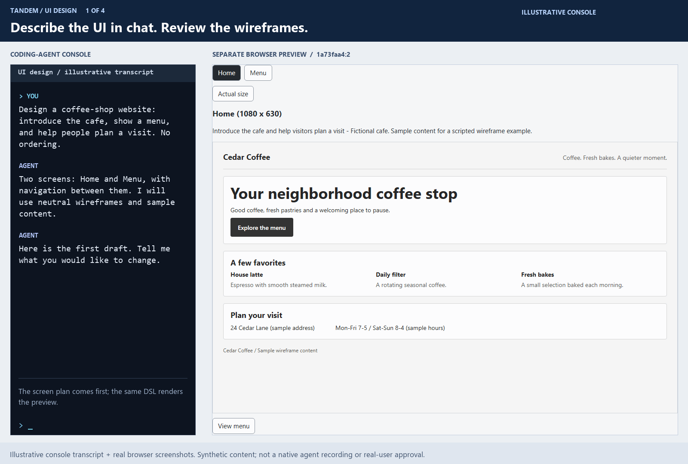

# UI design

Discuss the interface in your existing agent chat, see real rendered wireframes,
and revise them without rebuilding reviewed work. New ideas start with neutral
layout/content/navigation; existing supported UI-DSL styling is preserved.

This is an independent skill, not the Tandem framework or a working-app
prototype. Requirements and Brainstorm whiteboard are optional. Your agent's
normal account and permissions apply; no separate Copilot account is required.

## Load the skill

Copy this folder, or give your agent its actual `SKILL.md` path through the host's
normal instruction-loading capability. No npm install, build or startup is
needed to load instructions or discuss the design.

If the repository source you register includes this skill folder and its
Claude/Codex catalog entry, use your host's supported marketplace mechanism
to select `ui-design@tandem-skills` from that source. Check the selected source
or ref rather than assuming the default branch contains the skill. Avoid
replacing an existing registration or loading duplicate copies. Native
installation/activation varies by host and has not been qualified by package
tests. Direct loading from this local folder remains the starting point.

## What you see

The agent first shows the complete screen map and navigation in chat, then
renders the screens. Describe revisions in the same conversation. The viewer
has screen switching, navigation-only links, notes, fit/actual-size controls
and a visible version. It has no editor, question forms or approval buttons.

The agent refreshes the same preview when the host supports it; otherwise
refresh the browser and check the version the agent named. Local fields are
illustrative, not business logic or saved design edits. Refresh before final
review to restore the actual document values.

Confirmation happens explicitly in chat for the version actually displayed.
It covers layout/content/navigation and represented existing appearance, not
working behavior or permission to implement. Changes clear current confirmation.

## Demo

See the console-and-preview loop: a brief and screen plan, Home-to-Menu navigation,
a request to move "Plan your visit", and the updated Home with Menu preserved.



The console transcript is **hand-authored and scripted**, composited beside
actual renderer screenshots from a fresh synthetic design using a copied
package. The console is documentary illustration, not a web-chat feature in
the preview or a native Claude Code/Codex CLI recording. Navigation and the
single stable-ID move are real; no live agent/model, private conversation or
real-user approval is depicted. The final confirmation prompt has no fabricated
answer.

Capture used a temporary loopback server to display the unchanged self-contained
HTML. That was capture infrastructure, not a product dependency or proof of
offline file opening; the separate offline-file browser tests cover that path.
This walkthrough demonstrates the interaction and revision mechanics, not
model quality or native Claude/Codex qualification.

## Actual requirements and limitations

The packaged helper needs **existing Node 24+**, normal file/command permissions
and a browser or host HTML preview. It emits a self-contained local HTML file:
no server, watcher, internet connection, SDK or model backend. Consumers do not
need this repository's dependencies. A host without suitable execution or HTML
display can discuss intent but cannot be promised the rendered design loop.

The existing format allows 8 screens, 40 transitions and 256 KiB. Do not silently
drop accepted scope to fit. The catalog uses tokenized components, system fonts
and labeled image placeholders; arbitrary HTML/CSS/screenshots may not be
faithfully representable. Keep originals and disclose differences, rather than
claim a lossy substitute preserves their reviewed styling.

Temporary current state is not a durable store or revision history. The agent
keeps exact JSON in memory or necessary temporary artifacts, with at most one
retained view for error recovery. Missing state is reported, not reconstructed
as reviewed fact. Saving/exporting retained documents is explicit and optional,
using ordinary tools and repository conventions; it never implies publication.

## Agent-facing helper

Use the actual absolute helper path and a host/session **temporary** artifact
folder already available through normal permissions. Do not write into the
installed skill or production source folder. These mechanics are not a file
management task for the user.

Prepare `refs.json` as an array of actual brief/requirement reference IDs, such
as `["brief-booking"]`. Prepare an outline NDJSON file with all screen metadata
first, then all transitions, then `{"op":"done"}`. For example:

```json
{"op":"upsert-screen","screen":{"id":"booking","title":"Book a workshop","purpose":"Choose an available workshop","decisionIds":["brief-booking"],"width":960,"height":640,"notes":"Sold-out workshops show a clear availability note."}}
{"op":"done"}
```

Use absolute helper and temporary paths. Replace both examples below with
actual paths available in this host; shell path spelling depends on the host:

```powershell
$helper = "C:\path\to\ui-design\ui-design.mjs"
$work = "C:\actual\host-session-temp"
node $helper create --operations "$work\outline.ndjson" --references "$work\refs.json" --output "$work\preview.html"
node $helper read --preview "$work\preview.html"
node $helper update --preview "$work\preview.html" --base <id:version> --operations "$work\content.ndjson" --phase content
node $helper update --preview "$work\preview.html" --base <id:version> --operations "$work\edits.ndjson" --phase revision
```

`--base` is the exact current version returned by `read` and shown in the
preview, not the literal placeholder. Use the same preview path every time.

Content operations fill the established map; a minimal useful example is:

```json
{"op":"ui","screenId":"booking","edit":{"op":"add","parent":"screen","component":{"id":"title","type":"Heading","props":{"text":"Book a workshop"}}}}
{"op":"ui","screenId":"booking","edit":{"op":"add","parent":"screen","component":{"id":"name","type":"Input","props":{"label":"Your name","placeholder":"Name for the booking"}}}}
{"op":"done"}
```

Read [the generated contracts](references/authoring.md) before authoring.
Revisions patch existing IDs. To rebind changed references, supply the current
`--references refs.json` along with the required metadata edits; obsolete IDs
must be removed before the candidate can be published.

For an actual supplied version-2 multi-screen document (containing UI DSL v1), use:

```powershell
node $helper load --document "$work\design.json" --references "$work\refs.json" --output "$work\preview.html"
```

`load` preserves existing fidelity/tokens and refuses to overwrite a current
preview; it is not an implicit conversion or regeneration. `read` returns
`current` and optional `previous`, each containing the exact `document`.
To save a document on request, extract the chosen actual `document` through
normal file tools. There is no save/export project workflow.

Invalid operations leave the current file intact. If browser rendering fails,
the viewer tries the one retained document and explicitly names the older
version. Do not confirm the failed update. Read and patch the version actually
displayed; add `--recover-retained` explicitly to select that retained baseline
and assign a fresh version. Ordinary updates reject old versions. If no valid
state remains, report the loss and use an actual supplied
document or obtain permission to start a new draft.

## Maintainers

Instructions come from `buildUiDesignSkill()` in `src/planning-prompts.ts`.
`npm run build:ui-design` generates the helper, inline HTML template and
contract reference. `node --import tsx scripts\build-ui-design-skill.ts --check`
detects drift without writing. Root `package.json` remains the version source.
Maintain TypeScript/renderer assets in `src`, not the generated package.

Retain the MIT license, bundled Lucide notice and
[vendor provenance](references/ui-dsl-source.json). Deterministic fixtures,
offline browser checks and package isolation do not certify live model quality,
universal host capabilities or native catalog activation.
